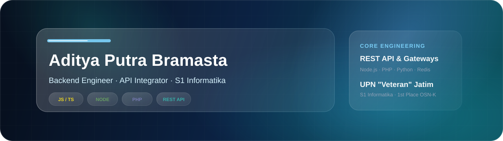

# 

  ☕ Backend Enthusiast | 🚀 High-Throughput REST APIs | 🧠 LLM &amp; AI Reverse Gateways | 🛡️ Web Infrastructure &amp; Security

  
  
  

## Tech Stack

  
  
  
  
  
  
  
  
  
  
  
  
  
  
  
  
  
  
  
  
  
  

## Currently Building

Building high-throughput API gateways, transactional automation backends, and distributed server utilities with a focus on reliability, fault tolerance, and low latency.

## Academic & Algorithmic Track Record

  🥇 <b>Juara 1 OSN-K Informatika</b> &bull; 🏅 <b>Peringkat 8 Paralel Saintek</b> &bull; 🧮 <b>Matematika Komputasi &amp; Algoritma</b> &bull; 🖥️ <b>Arsitektur Komputer</b>

## GitHub Statistics

<table>
  <tr>
    <td width="50%" align="center">
      
    </td>
    <td width="50%" align="center">
      
    </td>
  </tr>
</table>

## Contribution Activity

  <picture>
    <source media="(prefers-color-scheme: dark)" srcset="https://raw.githubusercontent.com/adityaputrabramasta/adityaputrabramasta/output/galaga-contribution-graph-dark.svg" />
    <source media="(prefers-color-scheme: light)" srcset="https://raw.githubusercontent.com/adityaputrabramasta/adityaputrabramasta/output/galaga-contribution-graph.svg" />
    
  </picture>

